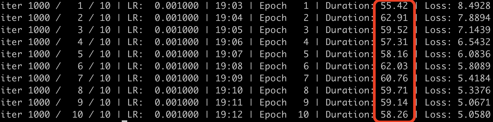
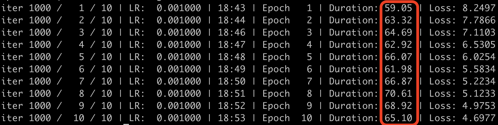

# alt-sdpa

alternative `Scaled-Dot-Product-Attention` function for `MLX`, 
supports `combined mask`(causal additive mask + positional encoding padding mask).

## Why?

`MLX`的内置`Transformer`函数`Scaled-Dot-Product-Attention`(缩放点积注意力)，

即`注意力计算函数`，内置的仅支持`additive mask`，不支持`组合mask`（即causal additive mask 和 padding mask),

遇到组合mask，计算注意力在 `Transformer` 中只能手动计算。

## Usage

`alt_sdpa` 这个扩展，就是为了将手动计算固定化，提供 `3个函数`，只需要简单参数提供`query`、`key`、`value`、`mask`即可：

  - `alt_sdpa_gpu` : 正式训练时应 `始终使用该函数`，属于在 C++ 中调用 mlx 内置函数，比纯python编写的alt_sdpa_mlx快约8%, 比 `alt_sdpa_cpu` 快约8倍；

  - `alt_sdpa_mlx` : 纯python手动计算；

  - `alt_sdpa_cpu` : 纯CPU实现，带有维度检测，仅适合开发用途（上面的alt_sdpa_gpu和alt_sdpa_mlx没有维度检测）；


这三个函数，运算结果`完全等价`（注意 `mask 必须是组合mask`）。

```python
import numpy as np
import mlx.core as mx
from alt_sdpa import *

attention = alt_sdpa_gpu(query, key, val, mask)

# mlx.core 必须在 alt_sdpa 之前 import
# query, key, val, mask 这4个参数必须为numpy矩阵类型，不能是 mlx 的 array 类型
# mask 必须是组合类型mask
# 如果仅仅是causal mask，你应该用mlx内置的 scaled_dot_product_attention
# 上面的 attention 即为 注意力值，
# 与内置的scaled_dot_product_attention逻辑一样，
# 区别仅仅在于：弥补了内置函数不支持组合mask的缺憾
```

## 预编译版本

直接下载 `Release` 中对应的预编译版本，打开 `example.py` 文件，即可看到使用示例：

```python
import os
import time
import math
import numpy as np
# mlx.core 必须在 alt_sdpa 之前 import
import mlx.core as mx
from alt_sdpa import *


# 测试矩阵计算注意力
# 模拟 transformer 中：
# batch_size为20，8个头，256维（所以head_dim为32）的英译中句子，句子长度为43
#
# [B, H, L, Dh]
B, H, L, Dh = 20, 8, 43, 32

query = np.random.randn(B, H, L, Dh).astype(np.float32)
key = np.random.randn(B, H, L, Dh).astype(np.float32)
val = np.random.randn(B, H, L, Dh).astype(np.float32)
mask = np.random.randn(B, 1, L, L).astype(np.float32)

# 3种计算注意力的方式，结果一样
gpu_attention = alt_sdpa_gpu(query, key, val, mask)
cpu_attention = alt_sdpa_cpu(query, key, val, mask)
mlx_attention = alt_sdpa_mlx(query, key, val, mask)

# 由于计算机的浮点数是有误差的，所以结果存在极小误差是正常的
# 这个误差一般仅体现在小数点7位或8为之后
print(f"将 mlx_attention 最终结果作为标准值：")
print(f"gpu结果误差: {np.max(np.abs(gpu_attention - mlx_attention)):.9f}")
print(f"cpu结果误差: {np.max(np.abs(cpu_attention - mlx_attention)):.9f}")


```


## 自行编译

  1） 克隆该仓库：

  ```Bash
  git clone https://github.com/harryzhu/alt-sdpa.git

  ```

  2） 执行 `build.sh`:

  ```Bash
  cd alt-sdpa
  ./build.sh

  ```

  3） `文件夹 alt_sdpa` 即为整个扩展包，编译完成之后，执行 `python example.py` 即可检查是否编译成功

  ```Bash
  python example.py

  ```

  4） 自行编译时(需要系统已经安装cmake： `brew install cmake`)，注意 `CMakeLists.txt` 中有一行

  ```Bash
  include_directories("/opt/anaconda3/lib/python3.13/site-packages/mlx/include")
  ```
  需要按照自己机器的实际路径修改， `pip install mlx ` 安装的 `MLX` 没有 `include` 这个文件夹， 需要`自编译安装`的 MLX 才有 include 这个文件夹。


## Performance

使用 `alt-sdpa` 扩展（`nanobind`）, 将纯python版本调用的 sdpa 计算移到 C++ 中，性能有约 `3%～8% 的提升`：

数据量越大，调用次数越多，在总体上的时间节省越多。

`alt-sdpa`扩展版本，也是100%调用的 mlx 算子，逻辑与纯手写python完全一样，

`唯一区别`就是把 `Python` 中的`注意力计算`移到了 `C++` 中运行，可以放心使用。




在python中纯手写sdpa计算注意力函数，10个epoch的训练时间：




